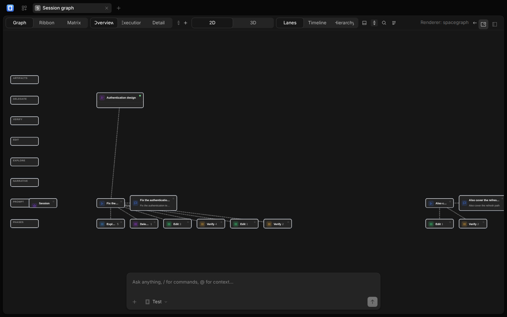

# Session graph (experimental)

> **Status: experimental prototype.** This is not a supported product surface. It is a companion
> artifact on `dev` for evaluating one hypothesis; the transcript remains the dependable baseline and
> the graph is an opt-in alternate view built entirely from existing session data.



## Motivation

Agent sessions are linear transcripts, but agent work is not linear: files are read, edited, tested,
reverted, and retried across a session. When activity becomes complex, questions like "why did this
file change?", "which calls led to this failure?", and "where did the agent retry?" get expensive to
answer by scrolling. This prototype tests whether **spatial navigation through relationships** is more
effective than **linear navigation through messages** for those questions.

The graph adds no data: it is built from `SessionMessageInfo`, status, and turn diffs. No protocol,
server, or session-schema change. The transcript keeps working if the graph fails to load.

## Setup

Prerequisites: Bun, the sibling `spacegraphjs` checkout (gitignored here), and a Playwright Chromium.

```bash
bun install                      # links the spacegraphjs workspace packages
```

The library toolchain (for the `spacegraphjs` repo only) is `cd spacegraphjs && pnpm install
--ignore-scripts --filter spacegraphjs`; do not run a full `pnpm install` there (it pulls the
`n8n-bridge` workspace and the native `canvas` build).

## Reproduce

```bash
# Screenshots (writes docs/spacegraph/screenshots/); --mode=verify asserts without overwriting
bun run graph:capture --mode=compare

# One-command conformance gate: both adapters, package boundaries, all packages, suites, capture verify
bun run graph:verify

# The app, with the graph behind the header toggle (desktop) or the graph.toggle command
bun run dev
```

The non-OpenCode reference host (no OpenCode import) runs from the library repo:

```bash
cd spacegraphjs && pnpm run dev:demo   # then open /contract.html
```

## Tested commit

OpenCode `dev` @ `f9c63d1b1b` + the docs pass; SpaceGraphJS code `3e4612a`. See
[prototype.md](./prototype.md) for the full tested-revision table, measurements, and the per-pass log.

## Limitations

The authoritative list is in [prototype.md](./prototype.md) §"Known limitations". The headline items:

- 2D is the legible default; 3D is an explicit experiment.
- Mobile graph mode is desktop-gated for v1 (command-only on mobile).
- Renderer choice (SpaceGraphJS vs Cytoscape) is a prototype setting, not a toolbar control.
- The `graph`/`ribbon`/`matrix` representation, the layout strategy, and the depth treatment are switchable
  options behind one seam; the R7.3 usability protocol decides the winner and is **not yet executed**.
- First graph paint and pan frame rate are unmeasured; the session-entry delta is unmeasured.

## Documents

- [prototype.md](./prototype.md) — hypothesis, architecture, how to run, measurements, limitations,
  evaluation protocol, capability audit, and the dependency migration plan.
- `SPACEGRAPH.md` (design) and `SPACEGRAPH.TODO.1.md` (plan) at the repo root.
- Library side: `spacegraphjs/AGENTS.md`, `docs/host-integration.md`, and `demo/contract.html`.
