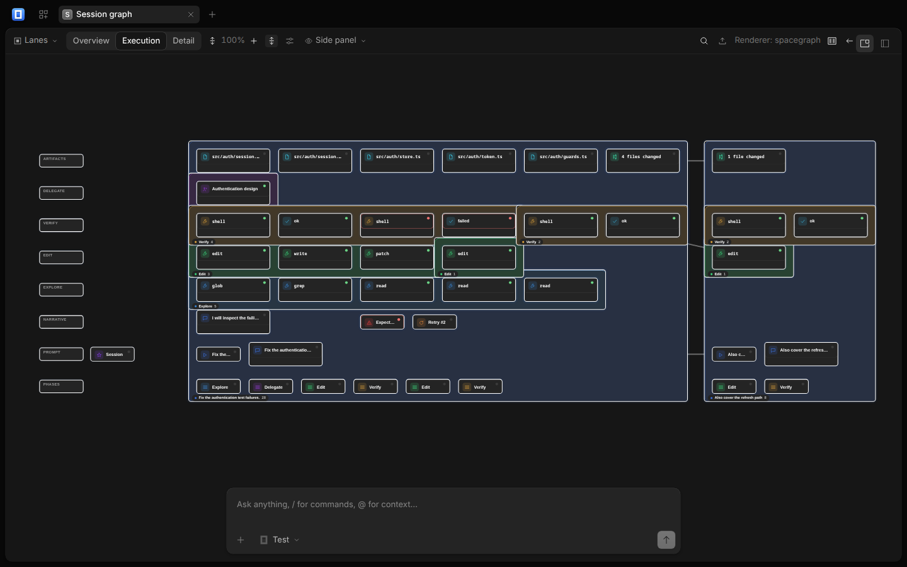
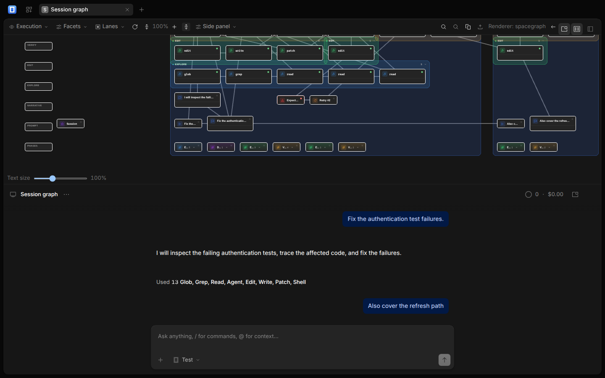
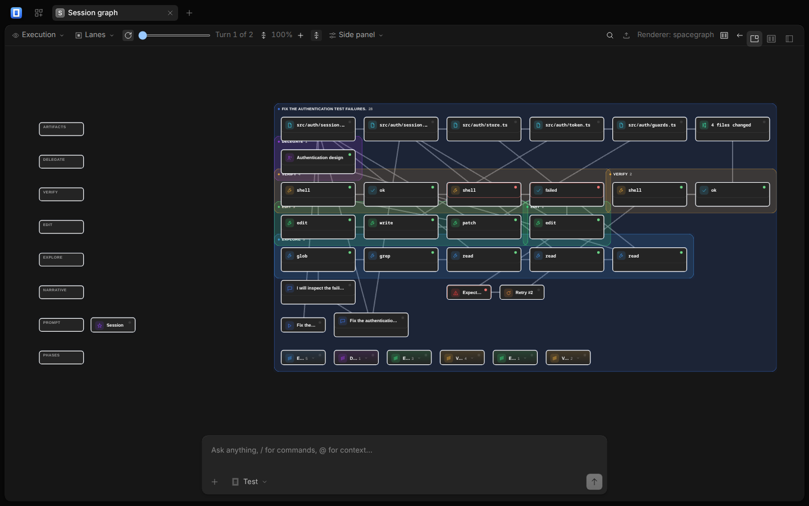
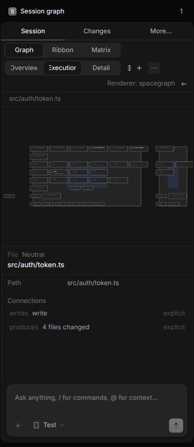

# SpaceGraph for OpenCode — Fork Landing Page

> **Experimental prototype.** An alternate, opt-in spatial view of agent sessions. The transcript remains the dependable baseline.

---

## Try it

```bash
git clone https://github.com/autonull/opencode-spacegraph
cd opencode-spacegraph
bun run graph:setup   # clones pinned SpaceGraphJS + installs deps
bun run graph:dev     # starts dev server (no provider needed)
```

[](https://github.com/autonull/opencode-spacegraph#try-it)

---

## What it does

When agent sessions grow complex, the transcript makes these questions expensive:

| Question | Transcript cost | Graph cost |
|----------|----------------|------------|
| Why did this file change? | Scroll, search, reconstruct | Click file → follow `writes` edges |
| Which calls led to this failure? | Read backward through messages | Select error → `why` trace highlights chain |
| What did the subagent contribute? | Find delegation, open child session | Subagent node → inspector opens its session |
| What changed after the failing test? | Scroll forward from failure | Frame failed turn → `follow log` syncs map |
| Where did the agent retry? | Buried in sequence | Execution level shows retry chains |

The graph is built from existing session data — no protocol, server, or schema changes. It's a pure, deterministic transformation.

---

## Key features

- **Three semantic levels** — Overview → Execution → Detail (progressive disclosure, not accordions)
- **Five layouts** — Lanes, Timeline, Hierarchy, Ribbon, Matrix, Tree, Force
- **Depth spectrum** — Flat, Layered, Depth-stack, Orbit (3D)
- **Hybrid mode** — Map + transcript side by side, or stacked, or floating overlay
- **Turn-map overlay** — Scoped subgraph of one turn over the transcript (`Mod+Alt+T`)
- **Permalinks** — `#graph:<layout>:<nodeID>` cold-load to framed node
- **Export** — SVG, JSON, standalone HTML
- **Accessibility** — Roving tabindex, ARIA live, screen-reader announcements
- **Two renderers** — SpaceGraphJS (2D+3D, WebGL) + Cytoscape (2D fallback), zero host branches

---

## Screenshots

### Overview (lanes, execution level, SpaceGraphJS)


### Execution detail with inspector


### Hybrid stacked (map above transcript)


### Turn map overlay


### Narrow viewport (mobile bottom sheet)


---

## Honest limitations (v1)

1. **Orthographic wheel zoom** keeps the point under the pointer in place
2. **Mesh selection outline** is axis-aligned `BoxHelper`, not silhouette; DOM cards use element outline
3. **Edge labels** avoid labels and DOM cards, not all geometry
4. **Global `SpaceGraph.instances`** remains as off-by-default dev handle
5. **`./activity` types stopgap** — replace with generated declarations
5. **Toolbar `endInset`** clears floating header toggles; desktop-media-query-gated
6. **Mobile graph mode** desktop-gated for v1; mobile reaches graph only via `graph.toggle` command
7. **Minimap vertically mirrored under Cytoscape** (model +y downward); correct under SpaceGraph
8. **Two adapter-failure e2e cases** dev-only (built chunks hashed); component suite covers seam
9. **First paint / pan frame rate** unmeasured — no graph perf harness
10. **Renderer selector** not in app toolbar; choice is prototype setting
11. **Swimlane bands** full-opacity under execution focus dimming (structure, not content)
12. **Lane gutter** is world-space (left of content, included in fit), not screen-fixed overlay
13. **Lanes overview** has dominant empty region (reserves execution width at overview)
14. **Empty-column exclusion** not implemented; fit frames content IDs
15. **Depth fade** is scene fog; DOM cards do not fade (HTML over canvas)
16. **Capture matrix** is one frame per option value, not cartesian product
17. **2026-10-19 visual review** found legibility defects; tracked T1.1–T1.18, layout-variety T7
18. **Long sessions** drawn as recent 60 turns + banner; layout measures whole session
19. **Five layouts are not comparable kinds** — three grid policies, two different geometries; best is unmeasured
20. **Middle-drag orbit** does nothing in an orthographic view; there is no orbit to have

[Full list in design doc →](./prototype.md#known-limitations)

---

## Documentation

| Doc | Audience |
|-----|----------|
| [Integration guide](./integration-guide.md) | **OpenCode users** — how to use SpaceGraph in your session |
| [Prototype write-up](./prototype.md) | Maintainers, community — architecture, measurements, evidence |
| [Upstream PR](./upstream-pr.md) | Maintainers — contribution ladder, diff budget, review questions |
| [Review packet](./upstream-review.md) | Maintainers — problem, hypothesis, results, security, ownership |
| [Security contract](./security.md) | Security reviewers — sanitization, CSP, non-goals |
| [Decisions (20 ADRs)](./decisions.md) | Anyone — every major choice with reason and fallback |
| [Surface vs Panel vs MobileView](./surface-vs-panel-vs-mobileview.md) | Plugin authors — when to use each API |

---

## Demo surfaces

| Surface | Command | Notes |
|---------|---------|-------|
| **Fork dev server** | `bun run graph:dev` | Mock backend, no provider needed |
| **Library contract demo** | `cd spacegraphjs && pnpm run dev:demo` → `/contract.html` | Framework-free, all 3 renderers |
| **Second host** | `cd spacegraphjs && pnpm run dev:demo` → `/second-host.html` | Plain TS, no OpenCode import |

Hosted (when deployed):
- Contract demo: `https://autonull.github.io/spacegraphjs7/contract.html`
- Second host: `https://autonull.github.io/spacegraphjs7/second-host.html`

---

## Verification

```bash
# Full gate (contract conformance, boundaries, all packages, suites, captures)
bun run graph:verify

# Screenshots
bun run graph:capture --mode=compare  # regenerate + inspect
bun run graph:capture --mode=verify   # assert committed set

# Performance budget
bun run graph:scale
```

---

## Upstream PR

**Not yet opened.** Will be opened after:
- [ ] All CI green
- [ ] Demo video recorded
- [ ] Animated SVG created
- [ ] Integration guide published
- [ ] Fork landing page live

See [upstream-pr.md](./upstream-pr.md) for the planned contribution ladder.

---

## License & Ownership

- **SpaceGraphJS**: MIT, developed in `spacegraphjs/` (sibling repo)
- **OpenCode integration**: Experimental, community-built, not an official OpenCode feature
- **Fork**: `autonull/opencode-spacegraph` (to be created post-upstream)

---

*Last updated: 2026-10-30*